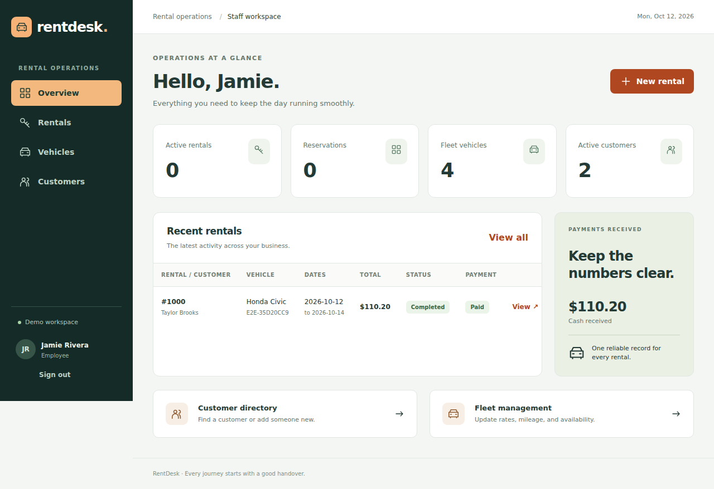
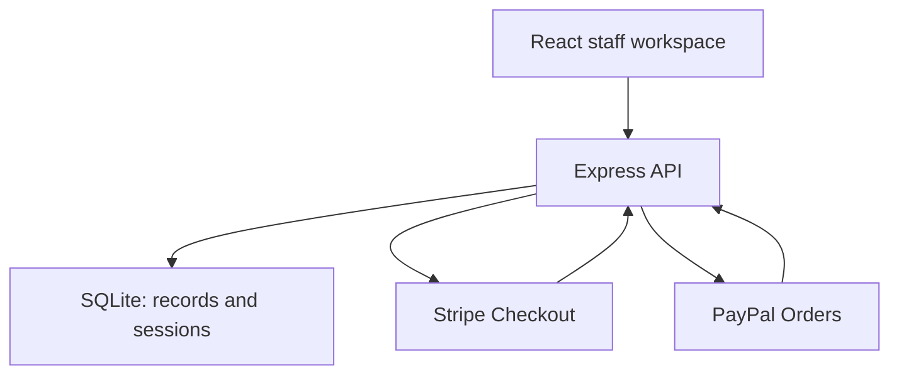

# RentDesk

A full-stack car rental workspace for employees and managers. Rebuilt from the original PHP project with React, TypeScript, Express, and persistent SQLite storage.



## What you can do

| Feature                                                       | Employee | Manager |
| ------------------------------------------------------------- | -------- | ------- |
| Create, edit, search, and archive customers                   | ✓        | ✓       |
| Create and edit vehicles, rates, service status, and odometer | ✓        | ✓       |
| Reserve, edit, cancel, hand over, and return rentals          | ✓        | ✓       |
| Record cash received and create Stripe/PayPal checkout links  | ✓        | ✓       |
| Verify payments and print rental records/receipts             | ✓        | ✓       |
| List, create, edit, and deactivate employee accounts          | —        | ✓       |

Employee authorization is enforced by the API. Deactivating an account or changing its password revokes its sessions. Managers cannot deactivate or demote themselves; an active manager must remain.

## Run locally

Requires **Node.js 24 LTS** and npm. No separate database installation or paid service is required for the local demo.

```bash
git clone https://github.com/AlexPrixman/rent_car.git
cd rent_car
npm ci
cp .env.example .env
npm run dev
```

Open **http://localhost:5173**. The first development startup creates sample customers, three vehicles, and these local-only accounts:

| Username   | Password       | Role     |
| ---------- | -------------- | -------- |
| `manager`  | `RentDesk123!` | Manager  |
| `employee` | `RentDesk123!` | Employee |

The default `PAYMENTS_MODE=demo` creates clearly labelled simulated Stripe and PayPal checkout links. No merchant account or real payment details are needed. Cash, reservations, pickup/return, receipts, roles, and persistent storage work in this mode. Demo and sandbox totals are labelled separately from real online payments in the dashboard.

Data and staff sessions are stored in `data/rentdesk.sqlite`, survive restarts, and are ignored by Git. Seeding preserves existing records. To run the built app on one port:

```bash
npm run build
PUBLIC_APP_URL=http://localhost:4000 npm start
```

Open http://localhost:4000. The API serves the built frontend and supports deep links. An optional local demo container is provided with `docker compose up --build`; it uses a persistent volume. Production configuration differs from this demo compose file.

## Rental workflow

1. Create an active customer and a vehicle with an available service status.
2. Choose dates and payment method. The return date is **exclusive**: Monday to Tuesday costs one daily rate. Rentals are limited to 365 days. Money is stored as integer cents, with the rate and customer/vehicle details saved on the reservation.
3. Record the full cash amount as received, or create and share a provider-hosted checkout URL. Pending checkout links lock rental terms; cancelling an unpaid link allows editing again.
4. Pick up a fully paid rental during its booked date range, recording the odometer. A vehicle with another active rental cannot be handed over.
5. Return the rental with an odometer at least as high as pickup. This closes the rental and updates the vehicle record.

Overlapping active/reserved bookings are rejected inside a SQLite write transaction; adjacent dates are allowed. Overdue active rentals conservatively block new reservations for their vehicle. Customers and vehicles with open rentals cannot be archived/retired. Cancellation releases reserved dates and retains payment history. **Cancellation does not refund money:** paid cancellations are flagged for staff review, with refunds handled in the merchant dashboard or cash register.

## Real Stripe and PayPal links

See [payment configuration and verification](docs/payments.md). Set `PAYMENTS_MODE=sandbox` and configure your merchant sandbox credentials in the server environment. Stripe uses a Checkout Session URL per rental. PayPal uses an Orders v2 approval URL, then server-side capture. Each represents the exact rental amount.

The app never trusts a success redirect as proof of payment. It verifies the saved provider order/session, currency, amount, and rental metadata, and accepts signed provider webhooks. Creation and capture retries use stable idempotency keys. Demo confirmation endpoints are disabled outside demo mode. An unconfigured provider is disabled in the UI and rejected by the API.

## Tests

```bash
npm test                         # API, domain/payment contracts, and React unit tests
npm run build                    # TypeScript + production bundle
npx playwright install chromium  # Add --with-deps on a clean Linux machine
npm run test:e2e                  # Desktop + mobile browser workflows
npm audit --audit-level=high
```

Playwright starts the **built frontend and real Express API** with an isolated, temporary SQLite database. It exercises both roles, customer and vehicle changes, employee account changes and revocation, cash through pickup/return/receipt, Stripe and PayPal demo links, booking conflicts, cancellation, and logout. Tests do not modify your development database.

Provider contract tests use the real Stripe SDK and mocked provider HTTP responses, including webhook signatures, amounts, idempotency, OAuth refresh, and capture/cancellation races. These are **not merchant sandbox transactions**. A real sandbox checkout/webhook roundtrip requires the operator’s Stripe/PayPal accounts and the manual checks in the payment guide.

GitHub Actions runs installation, dependency audit, API/frontend tests, production build, desktop/mobile Playwright checks, and a container build/smoke test on pushes and pull requests.

## Deployment and architecture

See [deployment and backup guide](docs/deployment.md) and [API routes](docs/api.md).



This app needs a Node.js server with persistent disk storage. GitHub Pages can host static sites, but cannot run this API or store the database. The provided Dockerfile runs the built frontend and API together. SQLite is intended for one API process on a persistent local volume; use a server database and a shared session store before scaling across multiple instances.

The initial scope uses full rental payments and daily pricing in USD, EUR, or GBP. Deposits, partial payments, automatic refunds, taxes, insurance, late fees, identity-document uploads, public customer booking accounts, and a database import from the original PHP app are not implemented. The original source remains in Git history and the `legacy-php` branch.
